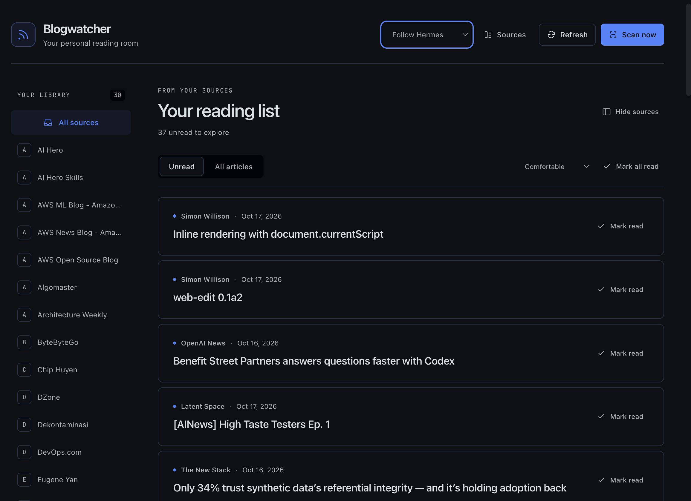
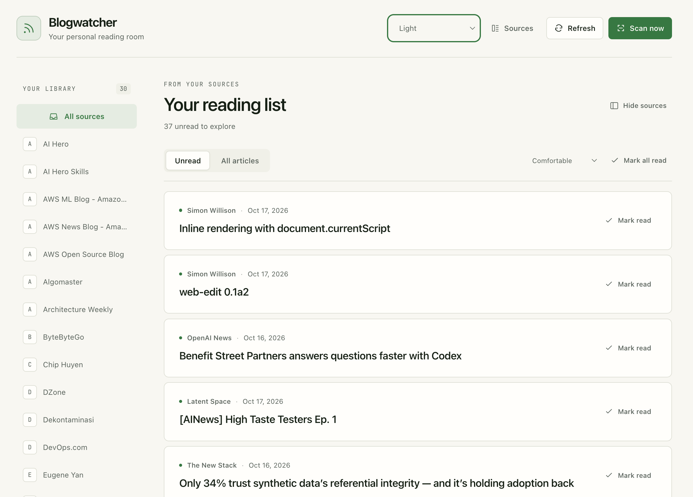
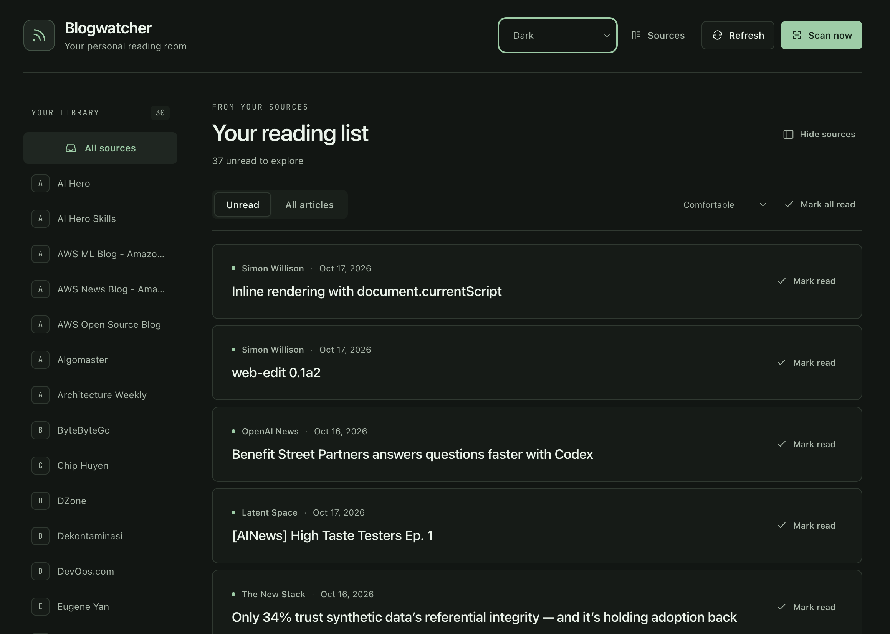

# Blogwatcher for Hermes

Read and manage your [Blogwatcher](https://github.com/Hyaxia/blogwatcher) subscriptions in Hermes Desktop and the web dashboard.

## Features

- Browse unread articles or your full inbox, filter by source, and mark articles read or unread. Results are paginated.
- Choose Follow Hermes, light or dark, and switch between comfortable and compact layouts.
- Open saved summaries inline and keep several articles expanded at once. Use Summarize or Regenerate when you want a new summary.
- Add sources and scan for new articles. Removing a source also deletes its articles.
- Let agents look up articles and subscriptions through read-only tools.

The plugin asks for confirmation before generating a summary from article text with your configured Hermes model. Your provider may charge for this, and Hermes may use retries or fallback models. Opening a saved summary doesn't fetch publisher content, call a model or mark the article read.

## Screenshots

### Follow Hermes



### Light



### Dark



## Install

Install the original Blogwatcher CLI on the **Hermes backend host**, with `blogwatcher` available on the service's PATH. This plugin doesn't support the `blogwatcher-cli` fork.

Install the plugin:

```bash
hermes plugins install https://github.com/irfansofyana/hermes-blogwatcher --enable
```

Restart the dashboard/API server, then open **Blogwatcher** in the web sidebar. If Desktop runs on that same machine, go to **Capabilities → Plugins → Rescan** and enable Blogwatcher.

### Remote Desktop clients

If Desktop runs elsewhere, copy `desktop/plugin.js` to this location on the client:

```text
~/.hermes/desktop-plugins/hermes-blogwatcher/plugin.js
```

Rescan and enable the local plugin. Keep the backend and Desktop copies in sync; the client needs neither Python nor Blogwatcher.

On the backend, you can set `BLOGWATCHER_BIN` to the CLI's absolute path and `BLOGWATCHER_DB` to override its database. The plugin uses your configured Hermes model, so you don't need a separate API key in the UI. Keep Hermes authentication enabled for remote access.

## Data and permissions

- The backend runs `blogwatcher` under the Hermes service account, using argument lists rather than a shell. The CLI inherits the service environment and accesses its existing database. Source and read-state actions modify that data; adding or scanning sources may contact their configured sites.
- Requested summaries use short-lived Python retrieval and DNS workers, which also inherit the service environment. They fetch public HTTP(S) pages; after confirmation, the retrieved text and source URL go to your configured Hermes model. Provider charges, retries and fallbacks may apply.
- Saved summaries, source URLs, coverage labels, timestamps and model metadata are stored in `cache/blogwatcher-summaries` under the active Hermes home. Results become stale after seven days. Eviction runs after cache writes and targets a 50 MiB limit; stale entries can remain until then. The plugin reads Hermes's model configuration for cache keys. Appearance and density preferences stay in browser-local storage.
- The plugin does not read credential stores directly or persist credentials. It collects no telemetry and starts no scheduler, persistent background service or self-updater.

## Development

Edit `ui/reader.js` and `ui/reader.css`, then rebuild and test:

```bash
node scripts/build-ui.cjs
node scripts/build-ui.cjs --check
hermes plugins validate .
python -m unittest discover -s tests -v
node --experimental-vm-modules --test tests/test_ui.cjs tests/test_desktop.cjs tests/test_reader_ui.cjs
```

Use an environment with Hermes/FastAPI for Python tests. CLI tests run against a temporary database. Live inference tests are opt-in and can incur costs.

See [browser previews and verification details](docs/verification/reader-ui.md) for additional checks.
